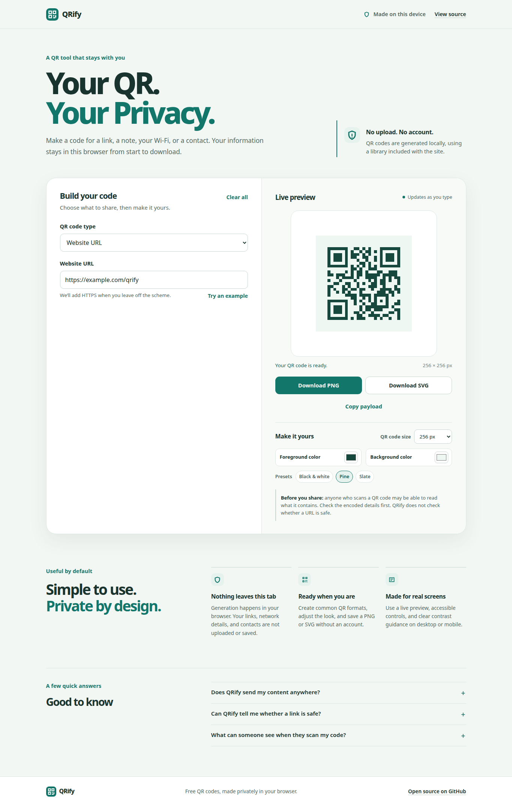

# QRify

**Free QR codes. Private by design.** QRify creates QR codes for links, notes, Wi-Fi networks, email addresses, phone numbers, and contact cards. Generation and downloads happen in your browser; no account or paid service is required.

[Open the live QRify generator](https://melvinvarghese.github.io/QRify/)



## Features

- Six formats: website URL, plain text, email, phone, Wi-Fi, and vCard contact.
- Live QR preview with medium error correction and a quiet zone.
- PNG and SVG downloads, plus a button to copy the encoded payload.
- Four output sizes (192, 256, 384, or 512 px), color controls, and three high-contrast presets.
- Input validation, clear/reset controls, and a contrast warning.
- Responsive layout, keyboard-visible focus, reduced-motion support, and system light/dark appearance.
- No build step, backend, analytics, advertising, or external runtime dependencies.

## Privacy and safe sharing

QRify runs its generator in the page you opened. The app does not send entered content to a server, use analytics, or save it to local or session storage. The page and its locally hosted assets are downloaded from GitHub Pages; the QR payload itself stays in browser memory. Copying uses the browser clipboard only after you choose **Copy payload**, and downloads are created on your device.

A QR code is not encrypted. Anyone who scans it may be able to read its contents. In particular, a Wi-Fi QR code includes the network password in its encoded payload. Check the code’s content before sharing it. QRify does not check whether a URL is safe or where it will lead.

## Use QRify

1. Choose the kind of information to encode.
2. Enter the content and review the preview.
3. Optionally change the size or colors. QRify warns when the color contrast is low, but that warning cannot guarantee that every scanner will read a code.
4. Download PNG or SVG, or copy the exact payload encoded in the QR code.

URL mode accepts HTTP or HTTPS and adds `https://` if you omit a scheme. Email and phone modes also accept `mailto:` and `tel:` links. Wi-Fi supports WPA/WPA2, WEP, and open networks. A contact card uses the vCard 3.0 format.

## Run locally

Python 3 is sufficient to serve the static files; no package installation or build is needed.

```bash
git clone https://github.com/melvinvarghese/QRify.git
cd QRify
python3 -m http.server 8000
```

Open <http://localhost:8000/>. To check that repository-relative assets also work under GitHub Pages’ `/QRify/` path, run the optional browser smoke test described below.

### Tests

The core tests use Node’s built-in test runner:

```bash
node --test tests/qrify-core.test.mjs
node --check assets/js/app.mjs
node --check assets/js/qrify-core.mjs
```

`tests/browser_smoke.py` is an optional Playwright/Chromium integration test covering all six input modes, UTF-8, validation, color/size, PNG/SVG, clipboard, local-only requests, and a mobile viewport. It requires Python Playwright and a local Chromium or Google Chrome installation; it is not a runtime dependency of the site.

## Deploy with GitHub Pages

The workflow in `.github/workflows/pages.yml` packages the repository root and deploys it with GitHub Pages Actions; there is no build step. It runs on pushes to `main` and can also be started manually from the repository’s **Actions** tab. The workflow uses the `github-pages` environment and only the permissions needed to read the repository and publish Pages.

When setting up a fork, choose **Settings → Pages → Build and deployment → Source → GitHub Actions**. The published URL for this repository is <https://melvinvarghese.github.io/QRify/>.

## Project layout

```text
.
├── .github/workflows/pages.yml       # GitHub Pages deployment
├── .gitignore                        # local files and test artifacts
├── .nojekyll                         # marker for branch-based Pages publishing
├── assets/
│   ├── css/styles.css                # responsive styles and color themes
│   ├── js/app.mjs                    # form, preview, clipboard, and downloads
│   ├── js/qrify-core.mjs             # payload validation and SVG renderer
│   ├── qrify-mark.svg                # local favicon
│   └── vendor/                       # local QR library and its license
├── docs/
│   ├── images/qrify-preview.png      # captured interface preview
│   └── superpowers/                  # design specification and implementation plan
├── tests/                            # core and optional browser tests
├── index.html
├── LICENSE
└── README.md
```

QR generation uses the standalone [`qrcode-generator`](https://github.com/kazuhikoarase/qrcode-generator) **2.0.4** distribution with its UTF-8 helper. The upstream MIT license and attribution are included at `assets/vendor/LICENSE-qrcode-generator`. QRify’s own source is released under the MIT License in `LICENSE`.

## Limitations

QRify creates codes; it does not scan them, encrypt their contents, verify a destination, or guarantee compatibility with every scanner. If the entered data exceeds the QR standard’s capacity, shorten it and try again. Always inspect a code before distributing it.

## Contributing

Issues and pull requests are welcome. Keep generation local to the browser, avoid adding trackers or external runtime requests, and run the core tests before submitting a change. Include a browser smoke-test result when changing the interface or QR output.
